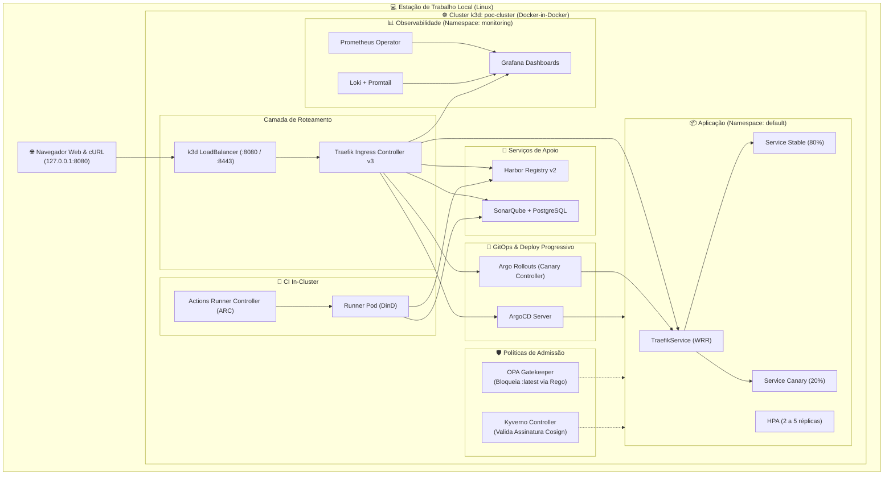

# 🚀 DevOps Local Concept — Prova de Conceito Kubernetes Local

[](https://k3d.io/)
[](https://argo-cd.readthedocs.io/)
[-F35552?logo=argo&logoColor=white)](https://argoproj.github.io/argo-rollouts/)
[-2088FF?logo=githubactions&logoColor=white)](https://github.com/actions/actions-runner-controller)
[](https://goharbor.io/)
[](https://www.sonarqube.org/)
[](https://trivy.dev/)
[](https://sigstore.dev/)
[](https://open-policy-agent.github.io/gatekeeper/)
[](https://grafana.com/)

---

## 🎯 Visão Geral do Projeto

O **DevOps Local Concept** é uma Prova de Conceito (POC) técnica concebida para demonstrar a criação e operação de um ambiente Kubernetes **100% local, autônomo, seguro e reprodutível**, sem nenhuma dependência de provedores de nuvem pública (Cloud-free).

A solução engloba todo o ciclo de vida da entrega contínua moderna: provisionamento de infraestrutura local, esteira de **DevSecOps** in-cluster, repositório de contêineres privado, análise estática de código (SAST), escaneamento de vulnerabilidades, assinatura criptográfica de artefatos OCI, entrega contínua declarativa (**GitOps**), deploy progressivo do tipo **Canary**, governança por **Políticas como Código** e stack completa de **Observabilidade** (métricas, logs e alertas).

---

## 🌟 Diferenciais Implementados na POC

O projeto cumpre **100% dos requisitos obrigatórios** do desafio técnico e entrega **todos os 4 diferenciais opcionais**:

- [x] **Assinatura e Verificação de Imagens com Cosign**: O pipeline assina o digest imutável da imagem e o **Kyverno** bloqueia a admissão de contêineres não assinados (`verifyImages`).
- [x] **GitOps com ArgoCD**: Reconciliação contínua e automatizada das aplicações a partir do repositório Git.
- [x] **Canary Deployment com Argo Rollouts**: Roteamento ponderado de tráfego (20% $\to$ 100%) integrado ao **TraefikService** do Traefik v3 sem necessidade de Service Mesh pesada.
- [x] **Alertas SRE no Prometheus**: Regras ativas (`PrometheusRule`) disparando notificações de teste no Prometheus Operator e Alertmanager.
- [x] **Contêiner Seguro com Google Distroless**: Aplicação Go compilada estaticamente (`CGO_ENABLED=0`), executada sem shell e sob o usuário não-root (UID `65532`), obtendo zero CVEs no Trivy.

---

## 🏗️ Topologia da Arquitetura



---

## ⚡ Pré-requisitos do Host

- **Sistema Operacional**: Linux (Ubuntu 22.04+ / Debian ou compatível)
- **Docker**: versão `>= 24.x` em execução
- **Recursos Recomendados**: 4 vCPUs, 8 GB de RAM livre, 30 GB de disco livre
- **Ferramentas**: `curl`, `git`, `jq`, `sudo`, `helm`, `kubectl`, `k3d`

### Configuração de Resolução de Nomes Local
Adicione os domínios da POC ao arquivo `/etc/hosts`:
```bash
echo "127.0.0.1 minha-app.local harbor.local argocd.local sonar.local rollouts.local grafana.local prometheus.local alertmanager.local" | sudo tee -a /etc/hosts
```

---

## 🚀 Guia de Instalação e Execução

### Opção 1: Setup da Stack de Monitoramento (Se o cluster já estiver rodando)
```bash
./scripts/install-monitoring.sh
./scripts/test-monitoring.sh
```

---

### Opção 2: Setup Automatizado de Toda a Infraestrutura (Bootstrap)
```bash
chmod +x scripts/*.sh

# (Opcional) Configure seu PAT do GitHub para o ARC runner se desejar rodar o CI:
export GITHUB_PAT="seu_token"

./scripts/bootstrap.sh
```

---

### Opção 3: Setup Completo do Zero (Passo a Passo)

#### 1. Criar o Cluster k3d com Portas Mapeadas
```bash
./scripts/install-k3d.sh
./scripts/create-cluster.sh
```

#### 2. Instalar o Harbor Registry Local
```bash
./scripts/install-harbor.sh
```

#### 3. Instalar o SonarQube (SAST)
```bash
./scripts/install-sonarqube.sh
```

#### 4. Instalar o Actions Runner Controller (ARC)
```bash
./scripts/install-arc.sh
```

#### 5. Instalar o ArgoCD (GitOps)
```bash
./scripts/install-argocd.sh
```

#### 6. Instalar o Argo Rollouts (Canary)
```bash
./scripts/install-rollouts.sh
```

#### 7. Instalar a Stack de Monitoramento (Prometheus + Grafana + Loki)
```bash
./scripts/install-monitoring.sh
```

#### 8. Ativar Aplicações GitOps no ArgoCD
```bash
kubectl apply -f apps/opa.yaml
kubectl apply -f apps/kyverno.yaml
kubectl apply -f apps/aplicacao.yaml
```

---

## 🌐 Tabela de Acessos e Credenciais

Com o `/etc/hosts` configurado, acesse as ferramentas via navegador na porta `8080`:

| Serviço | URL Local | Usuário | Senha Padrão | Finalidade |
| :--- | :--- | :--- | :--- | :--- |
| **Aplicação Web** | [http://minha-app.local:8080](http://minha-app.local:8080) | — | — | Aplicação Go com balanceamento Canary |
| **Health Check** | [http://minha-app.local:8080/healthz](http://minha-app.local:8080/healthz) | — | — | Endpoint de liveness/readiness |
| **Métricas Raw** | [http://minha-app.local:8080/metrics](http://minha-app.local:8080/metrics) | — | — | Métricas expostas para o Prometheus |
| **Harbor Registry** | [http://harbor.local:8080](http://harbor.local:8080) | `admin` | `Harbor12345` | Registry local privado OCI |
| **SonarQube** | [http://sonar.local:8080](http://sonar.local:8080) | `admin` | `Son@r12345!Admin` | Análise estática de código (SAST) |
| **ArgoCD** | [http://argocd.local:8080](http://argocd.local:8080) | `admin` | *(ver segredo abaixo)* | Dashboard GitOps |
| **Argo Rollouts** | [http://rollouts.local:8080/rollouts](http://rollouts.local:8080/rollouts) | — | — | Visualização do deploy Canary |
| **Grafana** | [http://grafana.local:8080](http://grafana.local:8080) | `admin` | `admin` | Dashboards de métricas e logs |
| **Prometheus** | [http://prometheus.local:8080](http://prometheus.local:8080) | — | — | Interface de queries e alertas |
| **Alertmanager** | [http://alertmanager.local:8080](http://alertmanager.local:8080) | — | — | Gestão de alertas ativos |

> 🔑 **Recuperar a senha do admin do ArgoCD:**
> ```bash
> kubectl -n argocd get secret argocd-initial-admin-secret -o jsonpath="{.data.password}" | base64 -d; echo
> ```

---

## 🔄 Pipeline DevSecOps (GitHub Actions + ARC)

O pipeline (`.github/workflows/ci-devsecops.yml`) roda nos runners efêmeros dentro do próprio cluster:
1. **Checkout & Testes**: Execução de testes unitários com cobertura (`go test -v -coverprofile=coverage.out`).
2. **SAST com SonarQube**: Validação de Quality Gate do código.
3. **Build Multi-Stage**: Criação da imagem Docker baseada em Google Distroless.
4. **Vulnerability Scan com Trivy**: Bloqueio de vulnerabilidades críticas/altas.
5. **Push no Harbor Local**: Envio da imagem tagueada com o SHA do commit.
6. **Assinatura Digital com Cosign**: Assinatura criptográfica do digest da imagem via chave privada.
7. **GitOps Auto-Update**: Atualização da tag da imagem em `charts/minha-app/values.yaml` com commit automático `[skip ci]`.

---

## 🛡️ Validação das Políticas de Segurança

### 1. Bloqueio de Imagem `:latest` (OPA Gatekeeper)
```bash
kubectl run test-latest --image=nginx:latest -n default
```
*Resultado Esperado:*
```text
Error from server (Forbidden): admission webhook "validation.gatekeeper.sh" denied the request: 
[disallow-latest-tag-default-ns] A imagem 'nginx:latest' usa a tag ':latest', o que é proibido pela política de segurança.
```

### 2. Bloqueio de Imagem Não Assinada (Kyverno)
```bash
kubectl run test-unsigned --image=harbor.local:8080/poc/minha-app:fake -n default
```
*Resultado Esperado:*
```text
Error from server: admission webhook "validate.kyverno.svc-fail" denied the request: 
failed to verify signature: no matching signatures found
```

---

## ⏪ Procedimentos de Rollback

### 1. Via Argo Rollouts (Recomendado)
```bash
# Inspecionar histórico
kubectl argo rollouts history rollout minha-app -n default

# Desfazer imediatamente para a versão estável anterior
kubectl argo rollouts undo rollout minha-app -n default
```

### 2. Via ArgoCD (GitOps)
Acesse a interface web em `http://argocd.local:8080` $\to$ Selecione a aplicação `minha-app` $\to$ Clique em **History and Rollback** $\to$ Escolha a revisão desejada e confirme.

### 3. Via Helm CLI
```bash
helm history minha-app -n default
helm rollback minha-app <REVISAO> -n default
```

---

## 🔧 Troubleshooting Rápido

Para problemas conhecidos de ambiente local (containerd HTTP, redirects do Harbor, `vm.max_map_count` do SonarQube, etc.), consulte o guia completo em [docs/troubleshooting.md](file:///home/gustavo/Documentos/DevOps_local_concept/docs/troubleshooting.md).

---

## 📚 Documentação Técnica e Relatórios

Toda a documentação aprofundada exigida pelo edital e detalhando a arquitetura encontra-se organizada na pasta `docs/`:

* [docs/relatorio-final.md](file:///home/gustavo/Documentos/DevOps_local_concept/docs/relatorio-final.md): **Relatório Final da POC** contendo a matriz de conformidade (100% dos requisitos + 4 diferenciais), decisões técnicas, dificuldades reais enfrentadas e retrospectiva/lições aprendidas.
* [docs/arquitetura.md](file:///home/gustavo/Documentos/DevOps_local_concept/docs/arquitetura.md): **Especificação da Arquitetura** com diagramas Mermaid, mapeamento de DNS/portas e matriz de componentes.
* [docs/decisões-tecnicas.md](file:///home/gustavo/Documentos/DevOps_local_concept/docs/decisões-tecnicas.md): **Justificativas Técnicas** comparando k3d vs Kind, Harbor vs Nexus, OPA vs Kyverno, Distroless e ARC.
* [docs/troubleshooting.md](file:///home/gustavo/Documentos/DevOps_local_concept/docs/troubleshooting.md): **Manual de Troubleshooting** com diagnósticos práticos, soluções para os problemas enfrentados e comandos de emergência.
* [docs/evidencias/](file:///home/gustavo/Documentos/DevOps_local_concept/docs/evidencias/): **Galeria de Evidências** com capturas de tela comprovatórias de cada componente em funcionamento.

---

## 📄 Licença
Distribuído sob licença MIT. Livre para fins educacionais e avaliação técnica.
