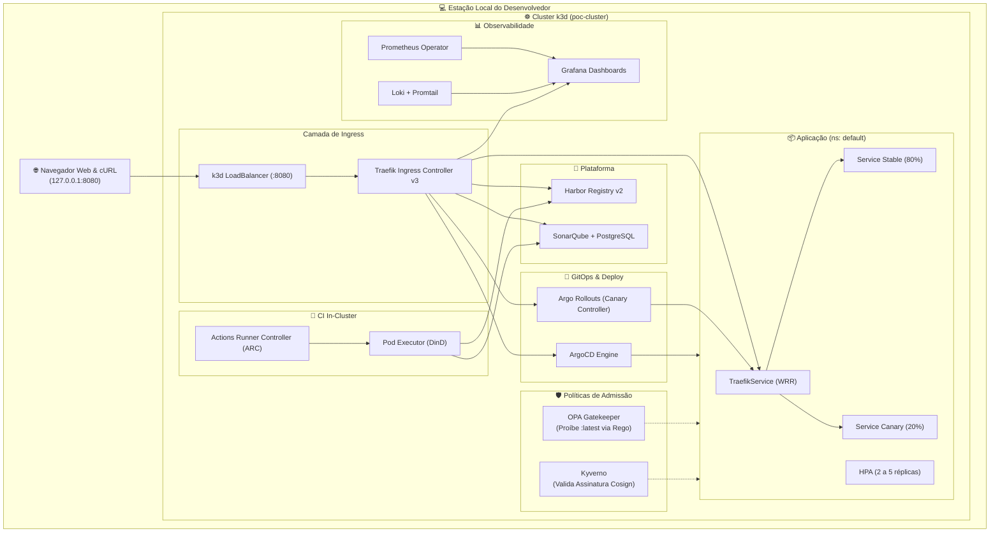
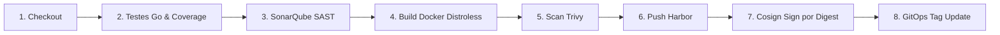

# 🚀 DevOps Local Concept — Prova de Conceito Kubernetes Local

[](https://k3d.io/)
[](https://argo-cd.readthedocs.io/)
[-F35552?logo=argo&logoColor=white)](https://argoproj.github.io/argo-rollouts/)
[-2088FF?logo=githubactions&logoColor=white)](https://github.com/actions/actions-runner-controller)
[](https://goharbor.io/)
[](https://www.sonarqube.org/)
[](https://trivy.dev/)
[](https://sigstore.dev/)
[](https://open-policy-agent.github.io/gatekeeper/)
[](https://grafana.com/)

---

## 🎯 Visão Geral

O **DevOps Local Concept** é uma Prova de Conceito (POC) de engenharia de software e infraestrutura moderna, concebida para demonstrar de ponta a ponta o ciclo de vida de uma aplicação em ambiente **Kubernetes 100% local**, **sem dependência de nuvens públicas (Cloud-free)** e totalmente reproduzível.

O projeto abrange automação completa de infraestrutura como código, esteira de **DevSecOps** in-cluster, entrega contínua orientada a **GitOps**, deploy progressivo do tipo **Canary**, governança rigorosa com **Políticas como Código (PaC)** e observabilidade corporativa (métricas e logs).

---

## 🌟 Diferenciais Implementados na POC

Além de atender a **100% dos requisitos obrigatórios** do desafio técnico, esta POC entrega **todos os 4 diferenciais opcionais**:

- [x] **Assinatura e Verificação Criptográfica de Imagens**: Pipeline assina o digest SHA256 da imagem via **Cosign** e o **Kyverno** valida a assinatura na admissão do Pod (`verifyImages`).
- [x] **GitOps com ArgoCD**: Gerenciamento declarativo contínuo de aplicações e infraestrutura a partir do repositório Git.
- [x] **Canary Deployment com Argo Rollouts**: Controle progressivo de tráfego (20% -> 100%) integrado nativamente ao **TraefikService** do Traefik v3.
- [x] **Alertas SRE no Prometheus**: Regras ativas (`PrometheusRule`) disparando notificações de teste no ecossistema do Prometheus Operator.
- [x] **Hardening com Google Distroless**: Contêiner final da aplicação em Go compilado estaticamente, sem shell e executado como `nonroot` (UID `65532`).

---

## 🏗️ Arquitetura da Solução



---

## 📁 Estrutura do Repositório

```text
DevOps_local_concept/
├── .github/workflows/
│   └── ci-devsecops.yml        # Pipeline completo DevSecOps (ARC runner)
├── apps/                       # Aplicações declarativas do ArgoCD (GitOps)
│   ├── aplicacao.yaml          # ArgoCD App da Minha-App (Rollout)
│   ├── kyverno.yaml            # ArgoCD App do Kyverno
│   ├── loki.yaml               # ArgoCD App do Loki + Promtail
│   ├── monitoring.yaml         # ArgoCD App do kube-prometheus-stack
│   └── opa.yaml                # ArgoCD App do OPA Gatekeeper
├── charts/
│   └── minha-app/              # Helm Chart completo da aplicação
│       ├── Chart.yaml
│       ├── values.yaml
│       └── templates/          # Rollout, TraefikService, IngressRoute, HPA, Service
├── docs/                       # Documentação técnica detalhada
│   ├── arquitetura.md          # Especificação aprofundada da arquitetura
│   ├── decisões-tecnicas.md    # Justificativas de engenharia e trade-offs
│   ├── troubleshooting.md      # Guia de diagnóstico e resolução de problemas
│   ├── relatorio-final.md      # Relatório formal da POC com galeria de evidências
│   └── evidencias/             # Capturas de tela comprovando a execução
├── manifests/
│   ├── monitoring/             # Datasource do Loki e regras de alerta Prometheus
│   └── policies/               # Políticas OPA (Rego) e Kyverno (verifyImages)
├── scripts/                    # Scripts de automação e bootstrap modular
│   ├── bootstrap.sh            # Orquestrador de setup ponta a ponta
│   ├── create-cluster.sh       # Criação do cluster k3d com portas mapeadas
│   ├── install-k3d.sh          # Instalação dos binários k3d e kubectl
│   ├── install-harbor.sh       # Instalação do Harbor e criação de robot accounts
│   ├── install-sonarqube.sh    # Instalação do SonarQube + Postgres + API setup
│   ├── install-arc.sh          # Instalação do ARC (GitHub Runner in-cluster)
│   ├── install-argocd.sh       # Instalação do ArgoCD com Ingress Traefik
│   ├── install-rollouts.sh     # Instalação do Argo Rollouts + RBAC Traefik
│   ├── cosign.sh               # Geração do par de chaves Cosign
│   └── cleanup.sh              # Teardown completo do ambiente
├── src/
│   └── simpleApp/              # Código-fonte da aplicação Go
│       ├── main.go             # Servidor HTTP com rotas /, /healthz e /metrics
│       ├── main_test.go        # Testes unitários automatizados
│       └── Dockerfile          # Multi-stage build com Google Distroless
└── README.md                   # Documento mestre de apresentação
```

---

## ⚡ Pré-requisitos do Host

- **Sistema Operacional**: Linux (recomendado Ubuntu/Debian ou compatível)
- **Docker**: versão `>= 24.x` em execução
- **Recursos Mínimos**: 4 vCPUs, 8 GB de RAM livres, 30 GB de disco livre
- **Utilitários**: `curl`, `git`, `jq`, `sudo`

### Configuração de Resolução de Nomes Local
Adicione os domínios da POC ao `/etc/hosts` da sua máquina:
```bash
echo "127.0.0.1 minha-app.local harbor.local argocd.local sonar.local rollouts.local grafana.local" | sudo tee -a /etc/hosts
```

---

## 🚀 Instalação e Execução

### Opção A: Bootstrap Automatizado
Para provisionar todo o ambiente de forma orquestrada:

```bash
chmod +x scripts/*.sh

# 1. Configurar variáveis para o Runner GitHub (ARC)
export GITHUB_PAT="seu_personal_access_token_com_permissao_repo"

# 2. Executar o bootstrap
./scripts/bootstrap.sh
```

---

### Opção B: Instalação Passo a Passo Modular

#### 1. Criar o Cluster k3d
```bash
./scripts/install-k3d.sh
./scripts/create-cluster.sh
```
*O cluster será criado com 1 Server e 2 Agents, mapeando a porta 8080 do host para a porta 80 do Traefik.*

#### 2. Instalar o Harbor Registry Local
```bash
./scripts/install-harbor.sh
```
*Instala o Harbor, cria o projeto `poc`, configura credenciais de robô e ajusta o containerd dos nós do k3d para aceitar o registry local via HTTP.*

#### 3. Instalar o SonarQube (SAST)
```bash
./scripts/install-sonarqube.sh
```
*Ajusta `vm.max_map_count=524288` no kernel do host, instala PostgreSQL dedicado, configura a senha do admin e gera o token de análise para o GitHub Actions.*

#### 4. Instalar o Actions Runner Controller (ARC)
```bash
./scripts/install-arc.sh
```
*Conecta o cluster ao GitHub para executar jobs do GitHub Actions em pods efêmeros com suporte a Docker-in-Docker.*

#### 5. Instalar o ArgoCD (GitOps)
```bash
./scripts/install-argocd.sh
```
*Instala o ArgoCD no namespace `argocd` e expõe a interface em `http://argocd.local:8080`.*

#### 6. Instalar o Argo Rollouts (Canary)
```bash
./scripts/install-rollouts.sh
```
*Instala o controlador de Rollouts, o dashboard visual e os privilégios RBAC para gerenciar os CRDs do Traefik.*

#### 7. Gerar Chaves Cosign (Assinatura de Imagens)
```bash
./scripts/cosign.sh
```
*Gera `cosign.key` e `cosign.pub`, exibindo a senha gerada para configuração nos Secrets do GitHub.*

#### 8. Ativar GitOps para Observabilidade e Políticas
Aplique as aplicações mestras no ArgoCD:
```bash
kubectl apply -f apps/opa.yaml
kubectl apply -f apps/kyverno.yaml
kubectl apply -f apps/monitoring.yaml
kubectl apply -f apps/loki.yaml
kubectl apply -f apps/aplicacao.yaml
```

---

## 🌐 Serviços e Credenciais de Acesso

Com as entradas configuradas no `/etc/hosts`, acesse os serviços no navegador:

| Serviço | URL Local | Usuário | Senha Padrão | Finalidade |
| :--- | :--- | :--- | :--- | :--- |
| **Aplicação Web** | [http://minha-app.local:8080](http://minha-app.local:8080) | — | — | Aplicação Go com balanceamento Canary |
| **Endpoint Healthz**| [http://minha-app.local:8080/healthz](http://minha-app.local:8080/healthz) | — | — | Health check retornando 200 OK |
| **Endpoint Metrics**| [http://minha-app.local:8080/metrics](http://minha-app.local:8080/metrics) | — | — | Métricas expostas para o Prometheus |
| **Harbor Registry** | [http://harbor.local:8080](http://harbor.local:8080) | `admin` | `Harbor12345` | Gestão de contêineres e artefatos OCI |
| **SonarQube** | [http://sonar.local:8080](http://sonar.local:8080) | `admin` | `Son@r12345!Admin` | Dashboard de qualidade e SAST |
| **ArgoCD** | [http://argocd.local:8080](http://argocd.local:8080) | `admin` | *(obtida via script de instalação)* | Painel GitOps de sincronização |
| **Argo Rollouts** | [http://rollouts.local:8080/rollouts](http://rollouts.local:8080/rollouts) | — | — | Dashboard visual do deploy Canary |
| **Grafana** | [http://grafana.local:8080](http://grafana.local:8080) | `admin` | `admin` | Dashboards de métricas e logs |

> 🔑 **Recuperar senha do admin do ArgoCD:**
> ```bash
> kubectl -n argocd get secret argocd-initial-admin-secret -o jsonpath="{.data.password}" | base64 -d; echo
> ```

---

## 🔄 Esteira CI/CD DevSecOps (GitHub Actions + ARC)

O pipeline (`.github/workflows/ci-devsecops.yml`) é executado dentro do cluster k3d nos pods do ARC e implementa a seguinte sequência:



1. **Checkout & Testes**: Execução de testes unitários com cobertura (`go test -coverprofile=coverage.out`).
2. **SAST com SonarQube**: Validação do Quality Gate do código-fonte.
3. **Build Multi-Stage**: Criação do contêiner leve e seguro com Google Distroless.
4. **Vulnerability Scanning**: Verificação de CVEs com Trivy (`severity: HIGH, CRITICAL`).
5. **Login e Push**: Publicação no Harbor local com a tag do SHA do commit.
6. **Assinatura Digital**: Assinatura criptográfica do digest da imagem via Cosign.
7. **Reconciliação GitOps**: Atualização da tag em `charts/minha-app/values.yaml` com commit automático `[skip ci]`.

---

## 🛡️ Validação das Políticas de Segurança

### 1. Teste de Bloqueio de Tag `:latest` (OPA Gatekeeper)
Tente executar um Pod utilizando a tag mutável `:latest`:
```bash
kubectl run teste-latest --image=nginx:latest -n default
```
**Resultado Esperado**:
```text
Error from server (Forbidden): admission webhook "validation.gatekeeper.sh" denied the request: 
[disallow-latest-tag-default-ns] A imagem 'nginx:latest' usa a tag ':latest', o que é proibido pela política de segurança.
```

---

### 2. Teste de Imagem Não Assinada (Kyverno)
Tente executar um Pod com imagem do Harbor sem assinatura Cosign:
```bash
kubectl run teste-nao-assinada --image=harbor.local:8080/poc/minha-app:sem-assinatura -n default
```
**Resultado Esperado**:
```text
Error from server: admission webhook "validate.kyverno.svc-fail" denied the request: 
failed to verify signature: no matching signatures found
```

---

## ⏪ Procedimentos de Rollback

Caso uma versão defeituosa seja propagada, o rollback pode ser efetuado de três maneiras:

### 1. Via Argo Rollouts (Recomendado para Deploys Progressivos)
```bash
# Inspecionar histórico de revisões
kubectl argo rollouts history rollout minha-app -n default

# Desfazer para a revisão anterior imediatamente
kubectl argo rollouts undo rollout minha-app -n default
```

### 2. Via ArgoCD (GitOps)
- Acesse a interface web do ArgoCD em `http://argocd.local:8080`.
- Clique na aplicação `minha-app` -> selecione **History and Rollback** -> escolha a versão desejada e confirme.

### 3. Via Helm CLI
```bash
helm history minha-app -n default
helm rollback minha-app <REVISAO_DESEJADA> -n default
```

---

## 📚 Documentação Técnica Aprofundada

Para explorar detalhes de engenharia, consulte os documentos dedicados na pasta `docs/`:

- [docs/arquitetura.md](file:///home/gustavo/Documentos/DevOps_local_concept/docs/arquitetura.md): Topologia completa, fluxos detalhados e matriz de portas e namespaces.
- [docs/decisões-tecnicas.md](file:///home/gustavo/Documentos/DevOps_local_concept/docs/decisões-tecnicas.md): Justificativas aprofundadas sobre k3d, Harbor, OPA vs Kyverno, Distroless e ARC.
- [docs/troubleshooting.md](file:///home/gustavo/Documentos/DevOps_local_concept/docs/troubleshooting.md): Guia de incidentes resolvidos (containerd HTTP, headers Traefik, `vm.max_map_count`, ServerSideApply).
- [docs/relatorio-final.md](file:///home/gustavo/Documentos/DevOps_local_concept/docs/relatorio-final.md): Relatório formal com matriz de conformidade e galeria de evidências.

---

## 🧹 Limpeza do Ambiente (Teardown)

Para remover completamente o cluster k3d e todos os recursos gerados:
```bash
./scripts/cleanup.sh
```

---

## 📄 Licença
Distribuído sob licença MIT. Livre para fins educacionais, avaliação técnica e experimentação.
