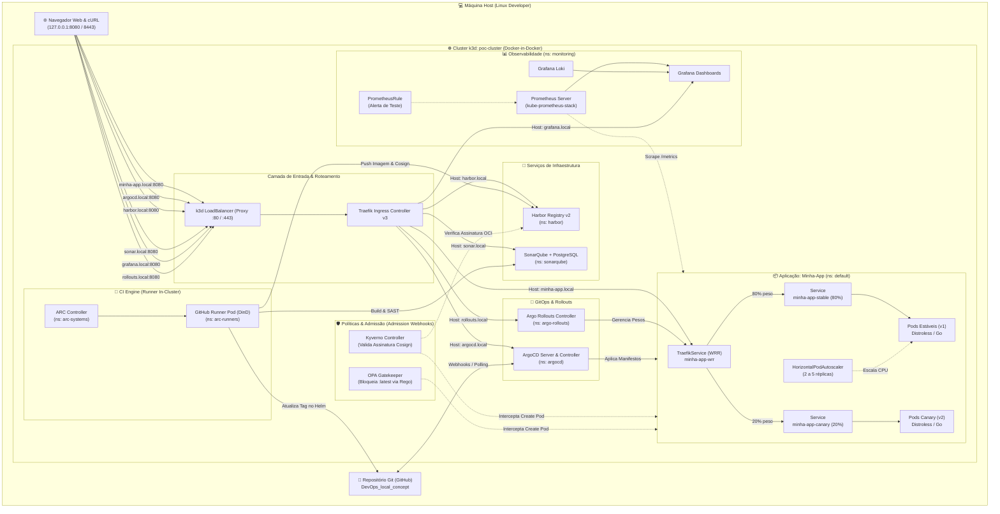
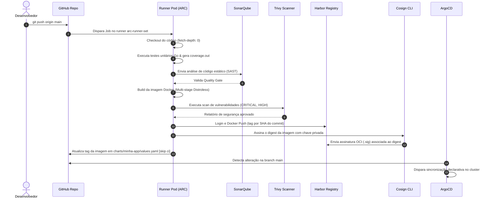
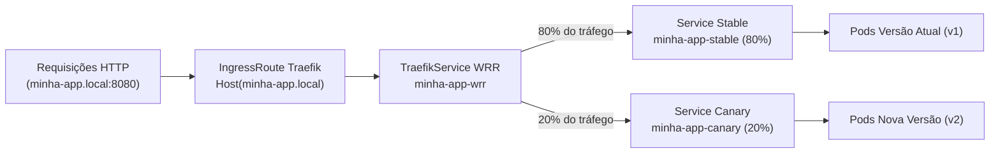
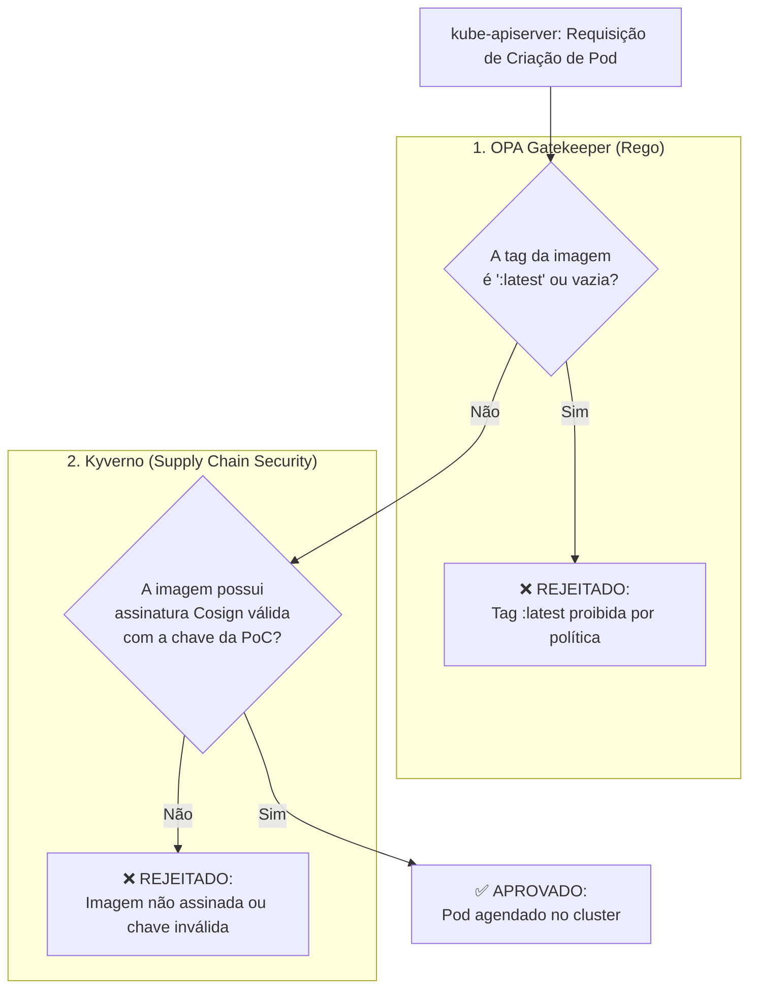

# 🏗️ Arquitetura da Solução: DevOps Local Concept

Este documento descreve detalhadamente a arquitetura de engenharia da Prova de Conceito (POC) de ambiente Kubernetes local, concebida para operar de forma 100% autônoma na máquina do desenvolvedor, sem dependências de nuvens públicas (Cloud-free).

---

## 📌 1. Visão Geral da Arquitetura

O ambiente foi projetado para simular uma esteira corporativa completa de **DevSecOps**, **GitOps**, **Observabilidade** e **Deploy Progressivo (Canary)**. Toda a stack roda em um cluster local Kubernetes provisionado sobre containers Docker via **k3d**, combinando baixo consumo de recursos e alta fidelidade com clusters de produção.

### Pilares Fundamentais:
1. **Cluster Local & Roteamento**: Kubernetes k3s via `k3d` com o controlador de Ingress **Traefik v3** nativo, expondo portas centrais (`8080` HTTP e `8443` HTTPS) para o host.
2. **Container Registry Local Privado**: **Harbor v2** gerenciando imagens de contêineres locais, repositórios OCI e artefatos de assinatura.
3. **CI/CD In-Cluster (DevSecOps)**: GitHub Actions acionado por agentes efêmeros locais via **Actions Runner Controller (ARC)**, orquestrando testes, análise estática de código (SAST) com **SonarQube**, verificação de vulnerabilidades com **Trivy**, push e assinatura digital com **Cosign**.
4. **GitOps & Continuous Delivery**: **ArgoCD** reconciliando o repositório Git com o cluster de forma declarativa.
5. **Estratégia de Deploy Progressivo**: **Argo Rollouts** realizando deploys do tipo **Canary** com controle dinâmico de tráfego via **TraefikService** (Weighted Round-Robin).
6. **Segurança em Camadas (Defense in Depth)**: **OPA Gatekeeper** (validação de tags mutáveis `:latest` via Rego) e **Kyverno** (verificação criptográfica de imagens assinadas com Cosign).
7. **Observabilidade Unificada**: Métricas coletadas pelo **Prometheus Operator** (`kube-prometheus-stack`), logs ingeridos pelo **Loki** com **Promtail**, dashboards no **Grafana** e regras de alerta ativas.

---

## 📐 2. Diagrama da Topologia Completa



---

## 🌐 3. Mapeamento de Rede e DNS Local

Para viabilizar o acesso unificado por nome em vez de portas aleatórias, as portas HTTP (`8080`) e HTTPS (`8443`) do host são roteadas diretamente para o Traefik Ingress Controller através do balanceador de carga do k3d.

Configuração do `/etc/hosts` no host:
```text
127.0.0.1 minha-app.local harbor.local argocd.local sonar.local rollouts.local grafana.local
```

### Matriz de Endereçamento e Serviços:

| Host DNS Local | Porta Host | Namespace | Serviço Interno Kubernetes | Ingress Controller | Finalidade |
| :--- | :--- | :--- | :--- | :--- | :--- |
| `minha-app.local` | `8080` | `default` | `minha-app-wrr` (TraefikService) | Traefik v3 | Endpoint da aplicação Go com roteamento Canary |
| `harbor.local` | `8080` | `harbor` | `harbor-portal:80` | Traefik v3 | Registry privado local OCI e scanner Trivy |
| `argocd.local` | `8080` | `argocd` | `argocd-server:80` | Traefik v3 | Interface e API do ArgoCD (GitOps) |
| `sonar.local` | `8080` | `sonarqube` | `sonarqube-sonarqube:9000` | Traefik v3 | Dashboard e API do SonarQube Community |
| `rollouts.local` | `8080` | `argo-rollouts` | `argo-rollouts-dashboard:3100` | Traefik v3 | Interface visual do Argo Rollouts |
| `grafana.local` | `8080` | `monitoring` | `monitoring-grafana:80` | Traefik v3 | Dashboards de métricas (Prometheus) e logs (Loki) |

---

## 🔄 4. Fluxos Operacionais de Ponta a Ponta

### 4.1. Fluxo de CI/CD DevSecOps (Pipeline Automatizado)
O pipeline (`.github/workflows/ci-devsecops.yml`) roda integralmente dentro do cluster k3d através do Actions Runner Controller (ARC):



---

### 4.2. Fluxo de Deploy Progressivo (Canary com TraefikService)
Em vez de utilizar o Deployment padrão do Kubernetes com RollingUpdate, a aplicação adota o Custom Resource **Rollout** gerenciado pelo **Argo Rollouts**:



1. Quando uma nova tag de imagem é submetida pelo pipeline, o Argo Rollouts detecta a mudança.
2. É criado um ReplicaSet Canary executando a nova versão.
3. O controlador do Argo Rollouts altera dinamicamente a definição do `TraefikService` para rotear **20%** do tráfego para os novos pods e **80%** para os pods estáveis.
4. Após uma pausa de observação (1 minuto configurado na POC), o tráfego é promovido para **100%** e os pods antigos são finalizados com segurança.

---

### 4.3. Fluxo de Segurança em Camadas (Admission Controllers)
O cluster implementa uma defesa em profundidade com dois controladores de admissão agindo em sinergia:



- **OPA Gatekeeper**: Utiliza um `ConstraintTemplate` e uma `Constraint` baseados em Rego para impedir que contêineres utilizem a tag mutável `:latest` ou submetam imagens sem tag definida.
- **Kyverno**: Utiliza uma `ClusterPolicy` com a diretiva `verifyImages` para inspecionar criptograficamente a assinatura no registry Harbor contra a chave pública pública Cosign (`cosign.pub`).

---

### 4.4. Fluxo de Observabilidade e SRE
- **Métricas da Aplicação**: A aplicação Go exporta métricas nativas do Prometheus no endpoint `/metrics` (`http_requests_total`). O Prometheus Operator realiza o scrape automaticamente por meio das anotações `prometheus.io/scrape: "true"` e `prometheus.io/port: "80"`.
- **Logs Centralizados**: O DaemonSet do **Promtail** lê os logs de contêineres diretamente de `/var/log/pods` nos nós do cluster e encaminha para o **Loki**.
- **Visualização Integrada**: O Grafana é provisionado com datasources automáticos (Prometheus e Loki) via sidecar com a label `grafana_datasource: "1"`.
- **Alertas**: A regra `manifests/monitoring/prometheus-alert-rule.yaml` injeta um alerta de validação (`AlertaDeTeste`) associado à release `monitoring`.

---

## 📋 5. Tabela de Componentes e Namespaces

| Namespace | Componente / Ferramenta | Papel na Arquitetura | Método de Instalação |
| :--- | :--- | :--- | :--- |
| `kube-system` | **Traefik v3** | Ingress Controller nativo do k3s | Built-in k3d |
| `harbor` | **Harbor v2** | Registry privado de imagens locais & OCI | Helm Chart (`scripts/install-harbor.sh`) |
| `sonarqube` | **SonarQube Community + PostgreSQL** | Análise estática de código (SAST) | Helm Chart (`scripts/install-sonarqube.sh`) |
| `arc-systems` | **ARC Scale Set Controller** | Operador do GitHub Actions Runner | Helm OCI (`scripts/install-arc.sh`) |
| `arc-runners` | **ARC Runner Set** | Pods executores do GitHub Actions com DinD | Helm OCI (`scripts/install-arc.sh`) |
| `argocd` | **ArgoCD v2.x** | Motor de GitOps para sincronização contínua | Helm Chart (`scripts/install-argocd.sh`) |
| `argo-rollouts`| **Argo Rollouts** | Controlador de estratégias de deploy (Canary) | Helm Chart (`scripts/install-rollouts.sh`) |
| `gatekeeper-system` | **OPA Gatekeeper** | Validador de conformidade e políticas Rego | Helm Chart / ArgoCD App (`apps/opa.yaml`) |
| `kyverno` | **Kyverno v1.13+** | Validador de supply chain e assinaturas Cosign | Helm Chart / ArgoCD App (`apps/kyverno.yaml`) |
| `monitoring` | **kube-prometheus-stack** | Prometheus, Grafana, Alertmanager | Helm Chart / ArgoCD App (`apps/monitoring.yaml`) |
| `monitoring` | **loki-stack** | Loki e Promtail para agregação de logs | Helm Chart / ArgoCD App (`apps/loki.yaml`) |
| `default` | **Minha-App** | Aplicação web Go, HPA, IngressRoute, Rollout | Helm Chart / ArgoCD App (`apps/aplicacao.yaml`) |

---

## 🔒 6. Isolamento e Segurança Operacional

1. **Execução sem Root**: A aplicação roda no contêiner sob o usuário não privilegiado `nonroot:nonroot` do Google Distroless (`UID 65532`).
2. **Cluster Local Seguro**: Todo o tráfego do registry e dos runners trafega pela rede interna virtual do Docker (`k3d-poc-cluster`), sem expor portas sensíveis diretamente à rede externa.
3. **Imutabilidade e Rastreabilidade**: Cada versão entregue possui identificação única atrelada ao SHA do commit do Git, assinada criptograficamente via Cosign com chaves geradas sob demanda.
