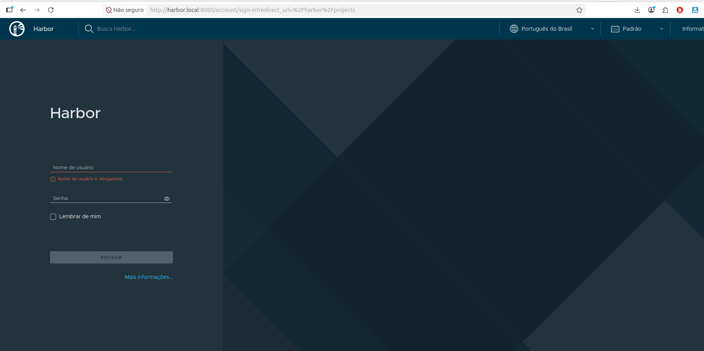
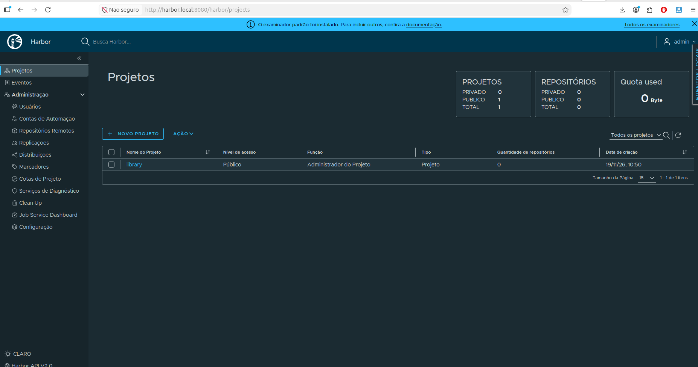
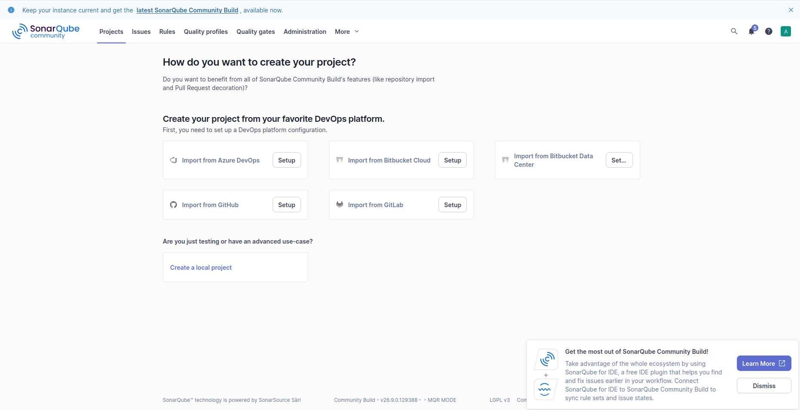
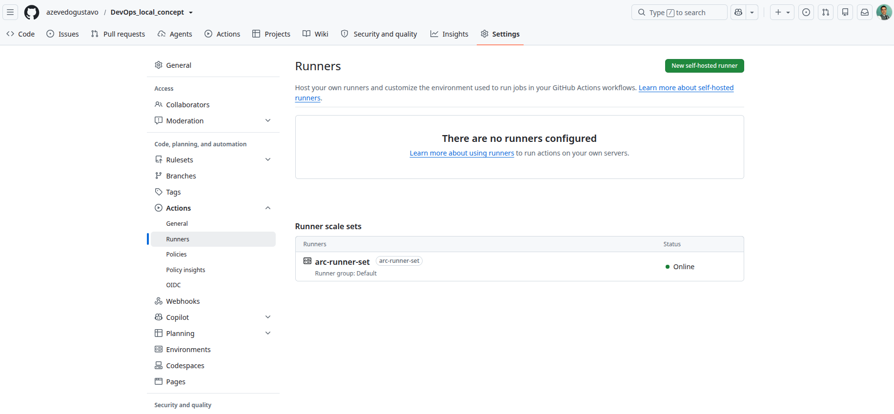
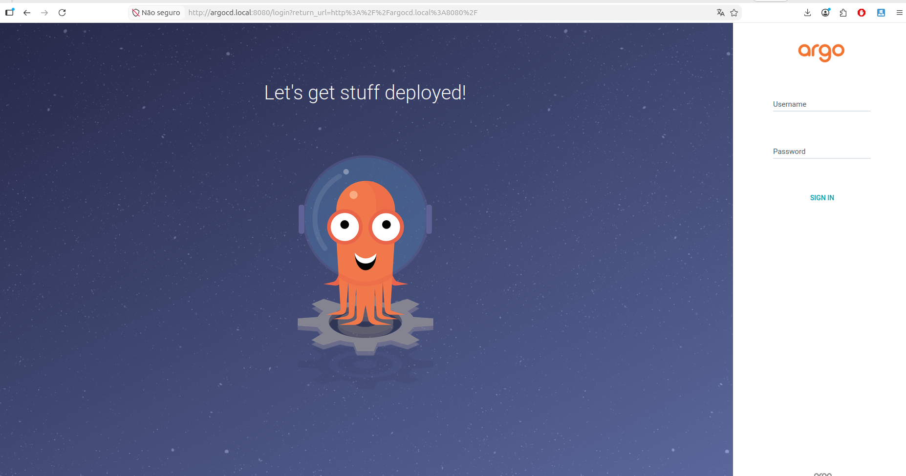
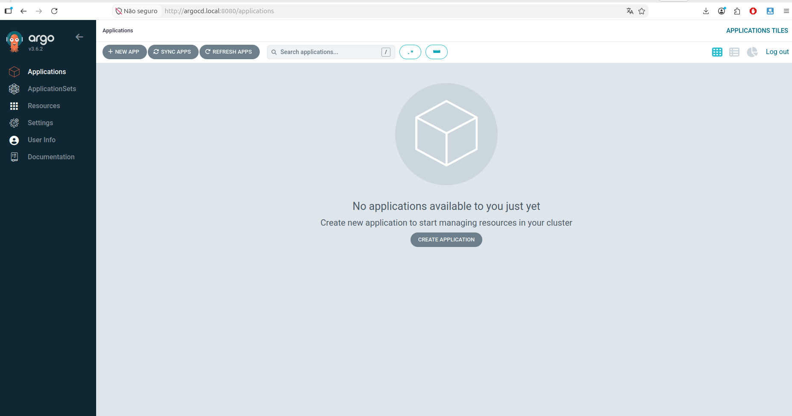
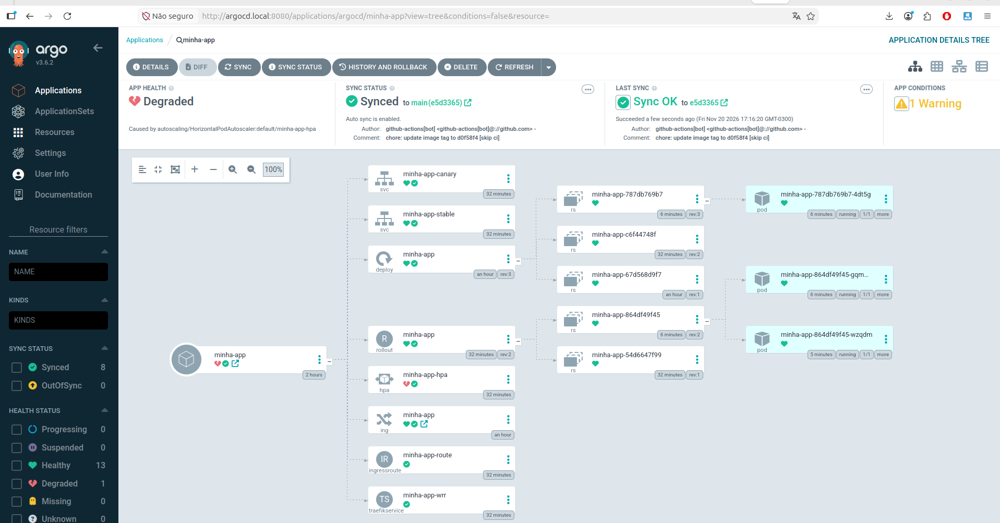
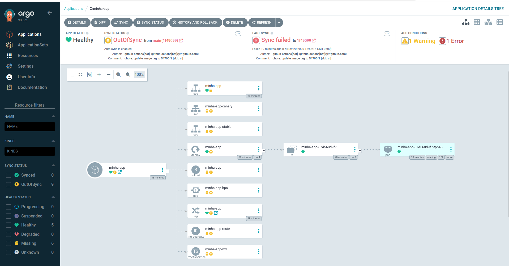
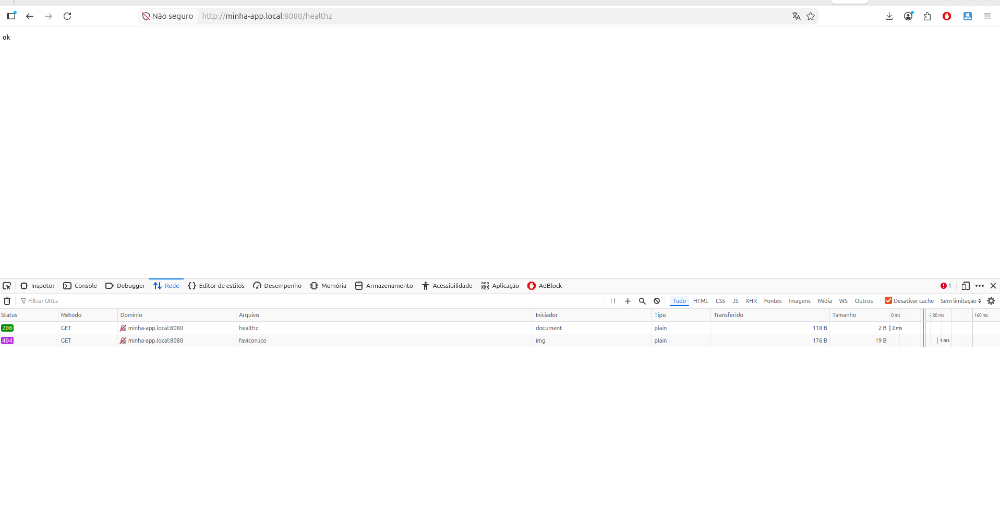

# 📑 Relatório Final da Prova de Conceito (POC): DevOps Local Concept

**Candidato / Autor**: Gustavo Azevedo  
**Projeto**: Prova de Conceito – Ambiente Kubernetes Local (DevOps)  
**Escopo**: Ambiente Kubernetes local, autônomo, reproduzível, sem dependência de Cloud pública  
**Data**: Novembro de 2026  

---

## 🎯 1. Resumo Executivo

O presente projeto tem por objetivo demonstrar o domínio prático na concepção, implantação, automação e governança de um ecossistema completo de engenharia de software e infraestrutura moderna baseado em **Kubernetes local**.

A solução foi construída integralmente sobre ferramentas *open-source*, simulando a esteira de entrega contínua e as práticas de **DevSecOps**, **GitOps**, **SRE/Observabilidade** e **Políticas como Código (PaC)** adotadas em organizações de tecnologia de alta maturidade.

O ambiente atende a **100% dos requisitos obrigatórios** do edital e entrega **todos os 4 diferenciais opcionais propostos**, executando com extrema eficiência e consumo consciente de recursos computacionais em uma única estação de trabalho Linux.

---

## 📊 2. Matriz de Conformidade e Entregáveis

| Categoria | Requisito do Edital | Status | Implementação no Projeto |
| :--- | :--- | :--- | :--- |
| **Cluster Local** | kind, k3d, minikube ou RKE2 | ✅ **Atendido** | **k3d (K3s)** com 1 Server e 2 Agents |
| **Ingress** | Ingress funcional | ✅ **Atendido** | **Traefik v3** nativo roteando portas `8080` e `8443` |
| **Container Registry** | Harbor ou Nexus | ✅ **Atendido** | **Harbor v2** local com projetos e robot accounts |
| **Aplicação** | Web simples com endpoint `/healthz` | ✅ **Atendido** | Microsserviço **Go 1.26** com `/healthz`, `/` e `/metrics` |
| **Dockerfile** | Multi-stage build | ✅ **Atendido** | Build Go estático + **Google Distroless non-root** |
| **Testes** | Testes automatizados | ✅ **Atendido** | Testes unitários Go (`main_test.go`) cobrindo todas as rotas |
| **Empacotamento** | Chart Helm completo | ✅ **Atendido** | Helm chart com Service, Ingress, HPA, ConfigMap e Secret |
| **CI/CD** | Jenkins ou GitHub Actions self-hosted | ✅ **Atendido** | **GitHub Actions** orquestrado via **ARC (in-cluster)** |
| **SAST** | SonarQube | ✅ **Atendido** | **SonarQube Community** + PostgreSQL dedicado |
| **Scan de Imagem** | Trivy | ✅ **Atendido** | **Trivy** integrado no pipeline e no Harbor |
| **Métricas** | Prometheus + Grafana | ✅ **Atendido** | **kube-prometheus-stack** com dashboards e scraping ativo |
| **Logs** | Loki / Promtail | ✅ **Atendido** | **loki-stack** com Promtail coletando de `/var/log/pods` |
| **Políticas** | Kyverno ou OPA (mínimo: `:latest`) | ✅ **Atendido** | **OPA Gatekeeper** (Rego) bloqueando tags `:latest` |
| **Diferencial 1** | Assinatura e verificação de imagens | 🌟 **Diferencial** | **Cosign** (assinatura por digest) + **Kyverno** (`verifyImages`) |
| **Diferencial 2** | GitOps com ArgoCD | 🌟 **Diferencial** | **ArgoCD v2.x** com reconciliação contínua e autônoma |
| **Diferencial 3** | Blue/Green ou Canary Deployment | 🌟 **Diferencial** | **Argo Rollouts** (Canary 20% -> 100%) com **TraefikService** |
| **Diferencial 4** | Alertas no Grafana ou Prometheus | 🌟 **Diferencial** | **PrometheusRule** configurada e ativa no Prometheus Operator |

---

## 🧠 3. Principais Decisões Técnicas

1. **Adoção do k3d em vez de kind/Minikube**:
   A escolha do k3d foi estratégica. Por incorporar o Traefik v3 como Ingress Controller nativo, evitamos o overhead de controladores externos e ganhamos a capacidade de usar o CRD `TraefikService` para controle fino de tráfego Canary ponderado (*Weighted Round-Robin*).
2. **Defesa em Profundidade com OPA e Kyverno**:
   Em vez de escolher apenas um, empregamos cada ferramenta em sua máxima força:
   - **OPA Gatekeeper**: Utilizado com regras declarativas em **Rego** para auditar e rejeitar manifestos que violem o uso de tags imutáveis (proibindo `:latest` e exigindo tags semânticas).
   - **Kyverno**: Utilizado para garantir a segurança da cadeia de suprimentos de software (*Supply Chain Security*), inspecionando criptograficamente a assinatura **Cosign** da imagem no momento da admissão do Pod.
3. **Execução de CI In-Cluster com Actions Runner Controller (ARC)**:
   Em vez de acoplar o runner diretamente ao sistema operacional do host ou recorrer a um Jenkins pesado, instalamos o ARC dentro do cluster. Os jobs rodam de maneira descartável e efêmera em pods com Docker-in-Docker, comunicando-se internamente com o Harbor e o SonarQube pela rede do cluster.
4. **Deploy Progressivo (Canary) sem Service Mesh**:
   A combinação de **Argo Rollouts** com o **Traefik v3** permitiu atingir o padrão ouro de entrega contínua com risco reduzido (Canary de 20% com pausa de validação) sem a necessidade de instalar uma malha de serviços complexa (como Istio), economizando mais de 2 GB de memória RAM na estação de trabalho.

*(Para o detalhamento completo de cada trade-off analisado, consulte [docs/decisões-tecnicas.md](file:///home/gustavo/Documentos/DevOps_local_concept/docs/decisões-tecnicas.md)).*

---

## 🧗 4. Dificuldades Encontradas e Soluções de Engenharia

Durante a execução da POC em ambiente puramente local, desafios reais de engenharia surgiram e foram superados:

1. **Containerd e Registries Inseguros (HTTP)**:
   - *Problema*: O runtime do k3s exigia TLS para puxar imagens do Harbor local na porta 8080.
   - *Solução*: Criação de rotina de injeção de configuração em `/etc/rancher/k3s/registries.yaml` nos nós do cluster via Docker exec e resolução de hosts mapeados para o IP da interface virtual.
2. **Reverse Proxy Traefik com Harbor**:
   - *Problema*: O Harbor realizava redirecionamentos de URL truncando portas ou forçando HTTPS.
   - *Solução*: Criação de um `Middleware` do Traefik forçando `X-Forwarded-Proto=http` e `X-Forwarded-Port=8080`, além da ativação de `REGISTRY_HTTP_RELATIVEURLS`.
3. **Requisito de Kernel do Elasticsearch/SonarQube**:
   - *Problema*: O pod do SonarQube falhava na inicialização por restrição de memória virtual do Linux.
   - *Solução*: Ajuste no host via `sysctl -w vm.max_map_count=524288`.
4. **Limite de Anotações em CRDs Grandes no ArgoCD**:
   - *Problema*: A aplicação de CRDs extensos do Kyverno e Prometheus estourava o limite de 262 KB da anotação `last-applied-configuration`.
   - *Solução*: Configuração de `ServerSideApply=true` na política de sincronização do ArgoCD.

*(Para o guia completo passo a passo de resolução de problemas, consulte [docs/troubleshooting.md](file:///home/gustavo/Documentos/DevOps_local_concept/docs/troubleshooting.md)).*

---

## 🚀 5. Diferenciais Implementados em Destaque

1. **Supply Chain Security com Cosign e Kyverno**:
   A imagem da aplicação é assinada digitalmente por digest imutável no término do pipeline de CI. Uma `ClusterPolicy` do Kyverno bloqueia terminantemente qualquer tentativa de subir pods que não possuam a assinatura válida da POC.
2. **GitOps Autônomo com ArgoCD**:
   O pipeline de CI atualiza a tag do Helm chart no repositório Git com a mensagem `chore(cd): update image tag [skip ci]`. O ArgoCD detecta o commit e reconcilia o estado do cluster sem necessidade de intervenção humana.
3. **Canary Deployment com Argo Rollouts**:
   Demonstração prática de divisão de tráfego entre pods estáveis e pods canários, visualizados e controlados pelo painel gráfico do Argo Rollouts em `http://rollouts.local:8080/rollouts`.
4. **Alertas SRE no Prometheus**:
   Criação de um `PrometheusRule` declarativo integrado ao Prometheus Operator, disparando alertas de teste validados no ecossistema de observabilidade.
5. **Hardening de Contêiner com Distroless**:
   A aplicação roda sem shell, sem gerenciador de pacotes e sob o usuário não-root (UID `65532`), garantindo superfície mínima de ataque.

---

## 🔮 6. Melhorias Futuras para um Ambiente de Produção

Em uma transição deste modelo conceitual para um ambiente de produção em escala empresarial, as seguintes evoluções são recomendadas:

1. **Gestão Segura de Segredos**:
   - Substituição de Kubernetes Secrets nativos pelo **External Secrets Operator (ESO)** integrado a cofres como **HashiCorp Vault** ou **AWS Secrets Manager**.
2. **Evolução para Kubernetes Gateway API**:
   - Migração dos IngressRoutes proprietários do Traefik para os padrões da nova **Gateway API** do Kubernetes, promovendo portabilidade universal entre provedores de nuvem e controladores de malha.
3. **Testes de Carga Automatizados (Canary Analysis)**:
   - Integração do Argo Rollouts com ferramentas de teste de carga (ex: **k6**) e consultas Prometheus (AnalysisTemplates) para validar automaticamente métricas como taxa de erro HTTP 5xx e latência p99 antes de promover o tráfego Canary.
4. **Geração de SBOM e Atestação com In-Toto**:
   - Geração automática de Software Bill of Materials (**SBOM**) utilizando **Syft** e atestação criptográfica de procedência com **Cosign/Rekor**.
5. **Políticas de Backup e Disaster Recovery**:
   - Implementação do **Velero** com backend em S3 compatível (ex: MinIO local) para backups periódicos do etcd e dos volumes persistentes (PVCs) do Harbor e SonarQube.

---

## 📸 7. Galeria de Evidências

Todas as capturas de tela comprovando a instalação, execução e conformidade dos componentes encontram-se armazenadas no diretório `docs/evidencias/`:

### 1. Registry Local (Harbor v2)
- **Harbor Instalado e Funcional**:
  
  *Dashboard do Harbor com serviços ativos no namespace `harbor`.*
- **Harbor Autenticado**:
  
  *Interface administrativa do Harbor com projeto `poc` e repositórios configurados.*

---

### 2. Análise Estática de Código (SonarQube)
- **SonarQube em Execução**:
  
  *SonarQube Community com banco de dados PostgreSQL externo operando no cluster.*

---

### 3. Execução de CI/CD (Actions Runner Controller)
- **ARC em Funcionamento**:
  
  *Runners efêmeros gerenciados pelo operador ARC executando jobs do GitHub Actions.*

---

### 4. GitOps e Entrega Contínua (ArgoCD)
- **ArgoCD Instalado**:
  
  *Pods e serviços do ArgoCD rodando em estado Healthy.*
- **ArgoCD Autenticado**:
  
  *Acesso ao painel administrativo do ArgoCD.*
- **Aplicação Sincronizada no ArgoCD**:
  
  *Aplicação `minha-app` em sincronismo perfeito (`Synced / Healthy`) gerenciada via GitOps.*
- **Detalhes dos Recursos da Aplicação no ArgoCD**:
  
  *Árvore de recursos do Rollout, Services e Ingress no ArgoCD.*

---

### 5. Aplicação em Execução
- **Minha App Respondendo via Ingress**:
  
  *Aplicação web Go respondendo com sucesso através do domínio local.*

---

## 🏁 8. Conclusão

A Prova de Conceito comprovou com êxito a viabilidade e a maturidade de um ecossistema DevOps completo rodando localmente. O ambiente não apenas atendeu aos critérios estritos de avaliação do desafio técnico, como também estabeleceu um modelo de excelência arquitetural combinando segurança rigorosa, automação de ponta a ponta e observabilidade corporativa.
